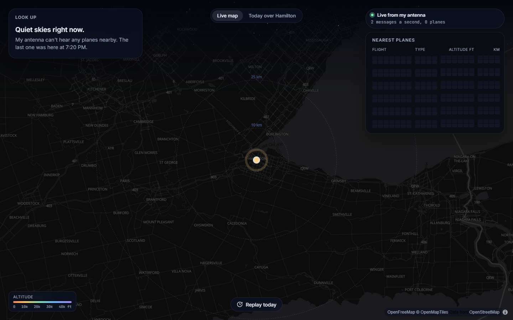
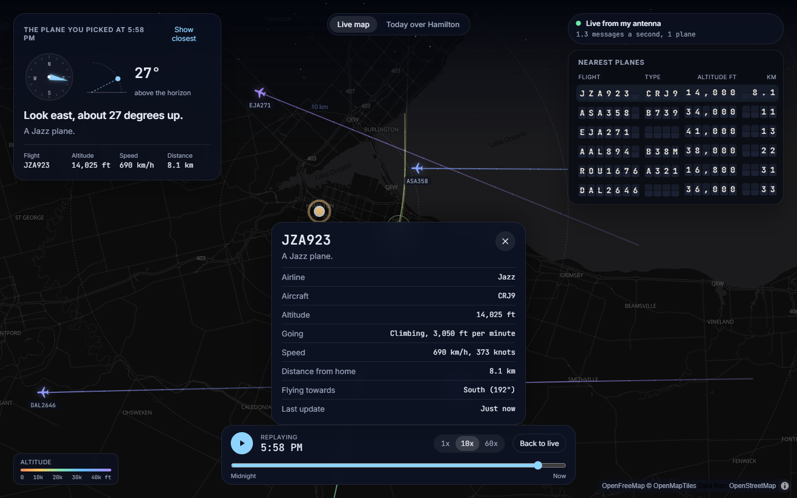
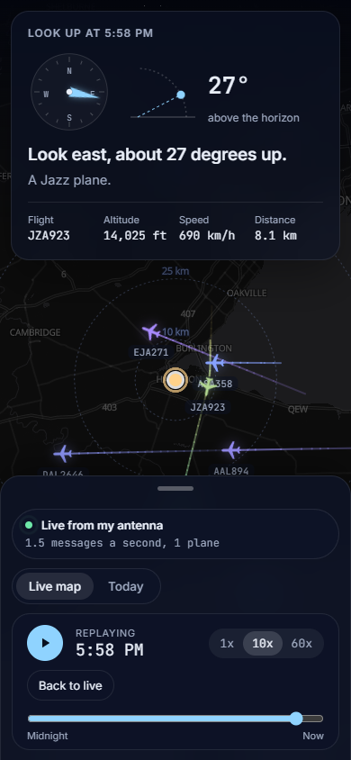
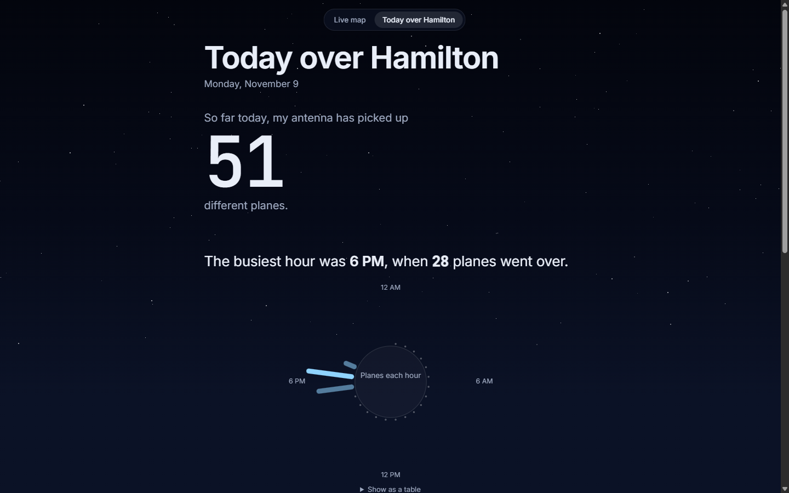
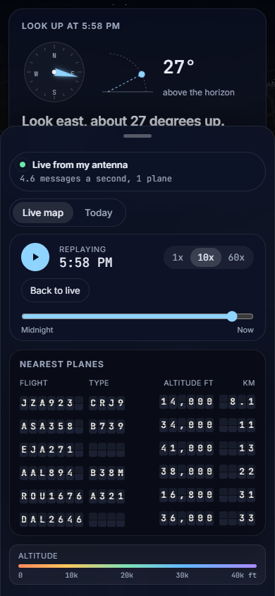
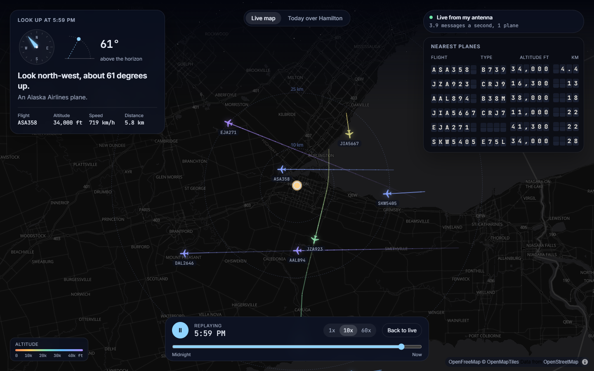
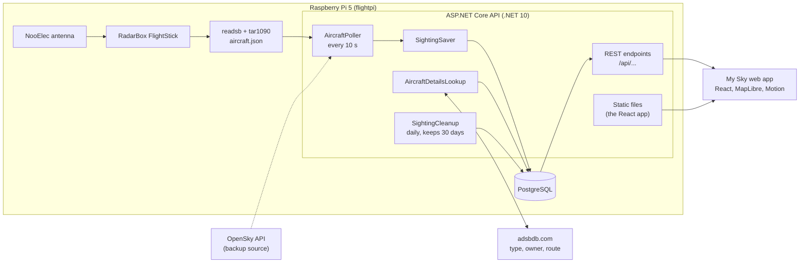

# My Sky: a flight tracker for Hamilton

My Sky shows what is flying over my home in Hamilton, Ontario, using planes picked up by my own ADS-B receiver on a Raspberry Pi. It is made for a normal person standing outside: it tells you which way to look and how high, and what the plane is, in plain words.



## What it does

- **Live map** of planes near Hamilton, colored by altitude, gliding smoothly between updates with fading trails.
- **Look Up card** for the closest plane: a compass direction, how many degrees above the horizon, and a sentence like "Look north-east, about 30 degrees up. Air Canada Boeing 737-8 heading to Montreal."
- **Plane details** in plain words when you tap a plane: airline, aircraft, altitude, speed, distance, direction and route (only when the route actually fits where the plane is going).
- **Split-flap board** with the 6 nearest planes.
- **Live sky background** that matches the real sky over Hamilton right now, from the sun position, with stars at night.
- **Day replay** of today's traffic at 1x, 10x or 60x.
- **"Today over Hamilton"**, the day's numbers told as a short story: planes today, the busiest hour on a 24 hour chart, top airlines, highest, fastest and lowest plane, and the first and latest plane of the day.
- **Receiver status chip** showing it is live from my antenna, with the message rate and plane count.
- Works on phones (everything except the Look Up card moves into a swipe-up sheet), with the keyboard, and with reduced motion.

## Screenshots

| Desktop | Phone |
| --- | --- |
|  |  |
|  |  |
|  | |

## How it fits together



- The **poller** reads planes from the receiver (or from OpenSky, picked by one setting) and saves a sighting for each new position.
- **Plane details** (registration, type, owner) are looked up once per plane on adsbdb.com and kept in the database. Routes are only kept in memory, because adsbdb's route data may not be copied into other databases.
- The **web app** polls the API every few seconds and does the rest in the browser: smooth movement, where to look, the sky colors and the replay.

## Tech stack

| Part | What I used |
| --- | --- |
| API | C#, ASP.NET Core minimal APIs, .NET 10 |
| Database | PostgreSQL, Entity Framework Core with Npgsql |
| Receiver | RadarBox FlightStick, readsb, tar1090 on a Raspberry Pi 5 |
| Plane data | adsbdb.com (details and routes), OpenSky (backup source) |
| Web app | React, TypeScript, Vite, MapLibre GL with OpenFreeMap tiles, Motion |
| Tests | xUnit with an in-memory SQLite database, Vitest |
| CI | GitHub Actions |

## API

| Endpoint | What it returns |
| --- | --- |
| `GET /api/health` | Status and server time |
| `GET /api/planes/live` | Planes seen in the last 2 minutes with their latest position, details and route |
| `GET /api/planes/overhead?limit=5` | The closest planes to home |
| `GET /api/planes/trails?minutes=5` | Recent positions of live planes |
| `GET /api/planes/{icao24}/history?hours=24` | The path of one plane |
| `GET /api/stats` | Today's numbers for the story page |
| `GET /api/replay?from=...&to=...` | All sightings in a time range (at most 2 hours) |
| `GET /api/receiver` | Data source, online or not, message rate, plane count |

`FlightTracker.Api/FlightTracker.Api.http` has a request for each one.

## Running it on a PC

You need the .NET 10 SDK, Node.js and PostgreSQL.

1. Create the database and an app user:

   ```sql
   CREATE ROLE flighttracker_app WITH LOGIN PASSWORD 'pick-a-strong-password';
   CREATE DATABASE flighttracker OWNER flighttracker_app;
   ```

2. Save the connection string as a user secret (it never goes in the repo):

   ```powershell
   cd FlightTracker.Api
   dotnet user-secrets set "ConnectionStrings:FlightTracker" 'Host=localhost;Port=5432;Database=flighttracker;Username=flighttracker_app;Password=YOUR_PASSWORD'
   ```

3. Create the tables and start the API:

   ```powershell
   dotnet tool restore
   dotnet ef database update
   dotnet run --launch-profile http
   ```

4. In a second terminal, start the web app and open http://localhost:5173:

   ```powershell
   cd web
   npm install
   npm run dev
   ```

By default the API reads planes from the receiver at `http://flightpi.local/tar1090/data/aircraft.json`. To use OpenSky instead, set `"AircraftSource": "OpenSky"` in `appsettings.json` and add your OpenSky API client to user-secrets as `OpenSky:ClientId` and `OpenSky:ClientSecret`.

## Running it on the Pi

- [docs/pi-receiver.md](docs/pi-receiver.md): setting up the antenna, readsb and tar1090.
- [docs/pi-deploy.md](docs/pi-deploy.md): PostgreSQL on the Pi, publishing from the PC, the systemd service and logs.

## Tests

```powershell
dotnet test FlightTracker.slnx
cd web
npm test
```

The API tests cover the parsers, the unit and distance math, the receiver status and every endpoint (against an in-memory SQLite database, so PostgreSQL is not needed). The web tests cover the Look Up math, the airline lookup, the replay and the sun position. GitHub Actions runs both on every push and pull request.

## Project layout

```
FlightTracker.Api/          the API
  Sources/                  where planes come from (readsb and OpenSky)
  Services/                 polling, saving, queries, stats, plane details
  Endpoints/                the REST endpoints and their DTOs
FlightTracker.Api.Tests/    xUnit tests
web/                        the My Sky React app
deploy/                     publish script, systemd service, example settings for the Pi
docs/                       Pi guides and screenshots
```

## What I learned

<!-- To fill in. -->
